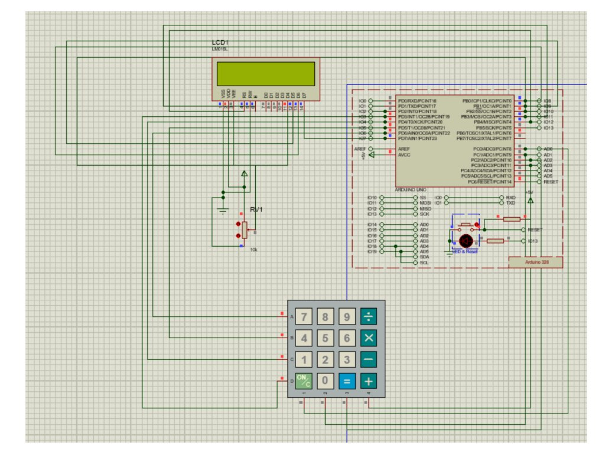

# Basic Calculator using Arduino UNO, 16x2 LCD & 4x4 Keypad

## Aim
To interface a 16x2 LCD and a 4x4 Matrix Keypad with Arduino UNO to perform basic arithmetic calculations (`+`, `-`, `*`, `/`) and display inputs and results directly on the LCD.

---

## Objects / Components Required

| S.No | Component Name | Proteus Library Keyword | Quantity | Purpose |
|:---:|:---|:---|:---:|:---|
| 1 | **Arduino UNO** | `ARDUINO UNO` or `SIMULINO UNO` | 1 | Microcontroller board |
| 2 | **16x2 LCD Display** | `LM016L` | 1 | Displays entered equation and result |
| 3 | **10k Potentiometer** | `POT-HG` or `POT` (RV1) | 1 | Contrast adjustment for Pin 3 (VEE) |
| 4 | **4x4 Calculator Keypad** | `KEYPAD-CALCULATOR` | 1 | Matrix keypad with `+`, `-`, `*`, `/`, `=`, `C` |
| 5 | **Power & Ground** | `POWER` (+5V) and `GROUND` | From Terminals Mode | DC power supply |

---

## Circuit Connections

### 1. 16x2 LCD (`LM016L`) to Arduino UNO
| LCD Pin Number | LCD Pin Name | Arduino UNO Pin | Description |
|:---:|:---|:---|:---|
| **Pin 1** | **VSS** | **GND** | Ground |
| **Pin 2** | **VDD** | **+5V (POWER)** | +5V Power Supply |
| **Pin 3** | **VEE** | **RV1 Wiper (Center Pin)** | Contrast (outer pins to +5V & GND, or wire to GND) |
| **Pin 4** | **RS** | **Digital Pin 12** | Register Select |
| **Pin 5** | **RW** | **GND** | Read/Write (tied to GND for write) |
| **Pin 6** | **E** | **Digital Pin 11** | Enable signal |
| **Pin 11**| **D4** | **Digital Pin 10** | Data bit 4 |
| **Pin 12**| **D5** | **Digital Pin 9** | Data bit 5 |
| **Pin 13**| **D6** | **Digital Pin 8** | Data bit 6 |
| **Pin 14**| **D7** | **Digital Pin 7** | Data bit 7 |

*(Pins 7, 8, 9, 10 on LCD are left unconnected in 4-bit mode).*

---

### 2. 4x4 Matrix Keypad to Arduino UNO
| Keypad Pin (Label on Proteus component) | Arduino UNO Pin | Keypad Row/Column Content |
|:---:|:---|:---|
| **A** (Top Row) | **Digital Pin 6** | Contains `7, 8, 9, /` |
| **B** (2nd Row) | **Digital Pin 5** | Contains `4, 5, 6, *` |
| **C** (3rd Row) | **Digital Pin 4** | Contains `1, 2, 3, -` |
| **D** (Bottom Row) | **Digital Pin 3** | Contains `C, 0, =, +` |
| **1** (1st Column) | **Analog Pin A0** | Contains `7, 4, 1, C` |
| **2** (2nd Column) | **Analog Pin A1** | Contains `8, 5, 2, 0` |
| **3** (3rd Column) | **Analog Pin A2** | Contains `9, 6, 3, =` |
| **4** (4th Column) | **Analog Pin A3** | Contains `/, *, -, +` |

---

## Keypad Layout Matrix

```
       Col 1 (A0)   Col 2 (A1)   Col 3 (A2)   Col 4 (A3)
Row A (6) [  7  ]      [  8  ]      [  9  ]      [  /  ]
Row B (5) [  4  ]      [  5  ]      [  6  ]      [  *  ]
Row C (4) [  1  ]      [  2  ]      [  3  ]      [  -  ]
Row D (3) [  C  ]      [  0  ]      [  =  ]      [  +  ]
```

- **`0` – `9`**: Digits for numbers
- **`+`, `-`, `*`, `/`**: Arithmetic operations
- **`=`**: Computes and displays the answer on the 2nd line
- **`C`**: Clears the display and resets the calculator

---

## Step-by-Step Procedure

### Step 1: Arduino IDE Compilation & Hex Generation
1. Open **Arduino IDE**.
2. Paste the code into [`Calculator.ino`](Calculator.ino).
3. Ensure the **Keypad** and **LiquidCrystal** libraries are available (LiquidCrystal is built-in; Keypad can be installed from Library Manager if missing).
4. Select Board: **Tools $\rightarrow$ Board $\rightarrow$ Arduino Uno**.
5. Click **Sketch $\rightarrow$ Export Compiled Binary** (`Ctrl + Alt + S` on Windows / `Cmd + Option + S` on Mac).
6. Verify that it compiles successfully and creates the `.hex` file.

### Step 2: Proteus Circuit Design
1. Open **Proteus ISIS**.
2. Press **P** to pick components:
   - `SIMULINO UNO` or `ARDUINO UNO`
   - `LM016L` (16x2 LCD display)
   - `KEYPAD-CALCULATOR` (or `KEYPAD-SMALLCALC`)
   - `POT-HG` (10k potentiometer for contrast, optional)
3. **Connect the LCD (`LM016L`)**:
   - `VSS` $\rightarrow$ `GROUND`
   - `VDD` $\rightarrow$ `POWER` (+5V)
   - `VEE` $\rightarrow$ Wiper pin of Potentiometer (or wire directly to `GROUND`)
   - `RS` $\rightarrow$ Arduino **Pin 12**
   - `RW` $\rightarrow$ `GROUND`
   - `E`  $\rightarrow$ Arduino **Pin 11**
   - `D4` $\rightarrow$ Arduino **Pin 10**
   - `D5` $\rightarrow$ Arduino **Pin 9**
   - `D6` $\rightarrow$ Arduino **Pin 8**
   - `D7` $\rightarrow$ Arduino **Pin 7**
4. **Connect the Keypad**:
   - Rows **A, B, C, D** (left side pins) $\rightarrow$ Arduino **Pins 6, 5, 4, 3**
   - Columns **1, 2, 3, 4** (bottom pins) $\rightarrow$ Arduino **Pins A0, A1, A2, A3**

### Step 3: Load Hex File & Run Simulation
1. Double-click the **Arduino UNO** board in Proteus.
2. In the **Program File** field, click the folder icon and select your compiled `.hex` file.
3. Click **OK**.
4. Click the **Play** button at the bottom-left to run the simulation.
5. LCD will display: `Calculator Ready` for 1.5 seconds, then clear.
6. Enter an equation:
   - Example 1: Press `8`, then `*`, then `5`, then `=`. LCD shows `= 40` on row 2!
   - Example 2: Press `C` to clear. Press `9`, then `/`, then `0`, then `=`. LCD displays `Err: Div/0`.

---

## Circuit Diagram


