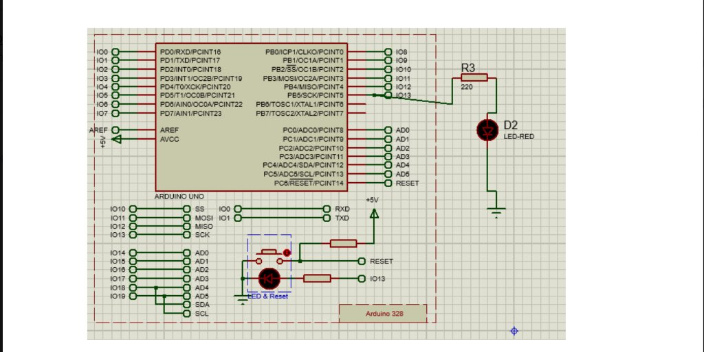

# Experiment 1: LED Blinking using Arduino UNO

## Aim
To interface an LED with Arduino UNO and blink it at 1-second intervals.

---

## Objects / Components Required

| S.No | Component Name | Proteus Library Keyword | Quantity | Purpose |
|:---:|:---|:---|:---:|:---|
| 1 | **Arduino UNO** | `ARDUINO UNO` or `SIMULINO UNO` / `Arduino 328` | 1 | Microcontroller board |
| 2 | **Resistor (220Ω)** | `RES` or `MINRES220R` | 1 | Current limiting resistor (R3) |
| 3 | **LED (Red)** | `LED-RED` | 1 | Output indicator (D2) |
| 4 | **Ground** | `GROUND` (from Terminals Mode) | 1 | Ground reference |

---

## Circuit Connections

| Component & Pin | Connects To | Description |
|:---|:---|:---|
| **Arduino Pin 13 (IO13)** | **Resistor R3 (one end)** | Digital output signal from PB5/SCK |
| **Resistor R3 (other end)**| **LED Anode (D2, flat/triangle base)** | Limits current into the LED |
| **LED Cathode (D2, bar / -)** | **GROUND (GND)** | Completes the circuit loop |

---

## Circuit Schematic

```
Arduino UNO
+-------------+
|             |
|   Pin 13    |---------[ 220Ω (R3) ]--------->| [LED-RED (D2)] --------+
|   (IO13)    |                                Anode   Cathode           |
|             |                                                         |
|             |                                                         v
|     GND     |<-------------------------------------------------- GROUND
+-------------+
```

---

## Proteus Simulation Steps

1. **Pick Components**:
   - Press **P** $\rightarrow$ Search `ARDUINO UNO` (or `SIMULINO UNO`).
   - Press **P** $\rightarrow$ Search `RES` (set value to `220`).
   - Press **P** $\rightarrow$ Search `LED-RED` (active animated LED).
   - Go to **Terminals Mode** (left panel) $\rightarrow$ Pick **GROUND**.
2. **Wire the Circuit**:
   - Connect Arduino **IO13** to **Resistor R3**.
   - Connect the other pin of **Resistor R3** to the **Anode** of **LED D2**.
   - Connect the **Cathode** of **LED D2** to **GROUND**.
3. **Load Hex File**:
   - In Arduino IDE, click **Sketch $\rightarrow$ Export Compiled Binary** (`Ctrl+Alt+S`).
   - Double-click the Arduino module in Proteus $\rightarrow$ Select the `.hex` file in **Program File**.
4. **Run Simulation**:
   - Click the **Play** button at the bottom-left corner.
   - The LED will blink ON for 1 second and OFF for 1 second.

---

## Circuit Diagram (Proteus Screenshot)



