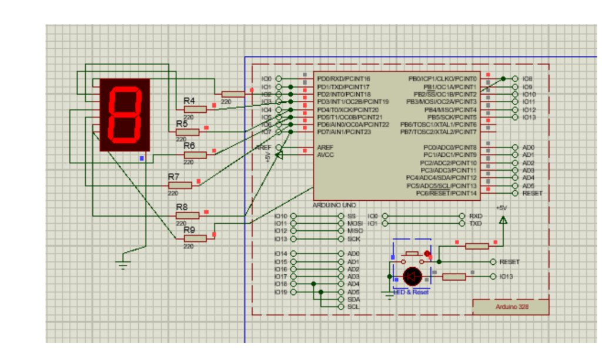

# Interfacing Seven-Segment Display with Arduino UNO

## Aim
To interface a 1-digit Common Cathode 7-Segment Display with Arduino UNO and display decimal digits from 0 to 9 in a cyclic loop with 1-second delay.

---

## Objects / Components Required

| S.No | Component Name | Proteus Library Keyword | Quantity | Purpose |
|:---:|:---|:---|:---:|:---|
| 1 | **Arduino UNO** | `ARDUINO UNO` or `SIMULINO UNO` / `Arduino 328` | 1 | Microcontroller board |
| 2 | **7-Segment Display** | `7SEG-COM-CATHODE` or `7SEG-MPX1-CC` (RED) | 1 | 7-Segment Common Cathode Display |
| 3 | **Resistors (220Ω)** | `RES` or `MINRES220R` | 7 | Current limiting (R4–R9, R3) |
| 4 | **Ground** | `GROUND` (from Terminals Mode) | 1 | Ground connection for Common Cathode |

---

## Circuit Connections

| 7-Segment Pin | Segment Name | Arduino UNO Pin | Connecting Resistor |
|:---|:---:|:---|:---|
| **Pin a** | a (Top horizontal) | **Pin 2 (IO2)** | 220Ω |
| **Pin b** | b (Top-right vertical) | **Pin 3 (IO3)** | 220Ω |
| **Pin c** | c (Bottom-right vertical) | **Pin 4 (IO4)** | 220Ω |
| **Pin d** | d (Bottom horizontal) | **Pin 5 (IO5)** | 220Ω |
| **Pin e** | e (Bottom-left vertical) | **Pin 6 (IO6)** | 220Ω |
| **Pin f** | f (Top-left vertical) | **Pin 7 (IO7)** | 220Ω |
| **Pin g** | g (Middle horizontal) | **Pin 8 (IO8)** | 220Ω |
| **Common Pin** | Cathode (COM) | **GND** | Direct to Ground |

---

## Segment Mapping Table (Common Cathode)

| Digit | a (Pin 2) | b (Pin 3) | c (Pin 4) | d (Pin 5) | e (Pin 6) | f (Pin 7) | g (Pin 8) |
|:---:|:---:|:---:|:---:|:---:|:---:|:---:|:---:|
| **0** | 1 | 1 | 1 | 1 | 1 | 1 | 0 |
| **1** | 0 | 1 | 1 | 0 | 0 | 0 | 0 |
| **2** | 1 | 1 | 0 | 1 | 1 | 0 | 1 |
| **3** | 1 | 1 | 1 | 1 | 0 | 0 | 1 |
| **4** | 0 | 1 | 1 | 0 | 0 | 1 | 1 |
| **5** | 1 | 0 | 1 | 1 | 0 | 1 | 1 |
| **6** | 1 | 0 | 1 | 1 | 1 | 1 | 1 |
| **7** | 1 | 1 | 1 | 0 | 0 | 0 | 0 |
| **8** | 1 | 1 | 1 | 1 | 1 | 1 | 1 |
| **9** | 1 | 1 | 1 | 1 | 0 | 1 | 1 |

---

## Step-by-Step Procedure

### Step 1: Arduino IDE Setup & Code Compilation
1. Open **Arduino IDE**.
2. Create a new sketch and paste the code from [`Seven_Segment.ino`](Seven_Segment.ino).
3. Select Board: **Tools $\rightarrow$ Board $\rightarrow$ Arduino AVR Boards $\rightarrow$ Arduino Uno**.
4. Go to **Sketch $\rightarrow$ Export Compiled Binary** (`Ctrl + Alt + S` on Windows, `Cmd + Option + S` on Mac).
5. This generates a `.hex` file inside the sketch directory.

### Step 2: Proteus Circuit Design
1. Open **Proteus ISIS**.
2. Press **P** (Pick Devices) and search for:
   - `ARDUINO UNO` (or `SIMULINO UNO` or `Arduino 328`)
   - `7SEG-COM-CATHODE` (or `7SEG-MPX1-CC`)
   - `RES` (220 ohm resistors)
3. Place the components on the workspace.
4. Connect seven **220Ω resistors** in series between Arduino pins **2 to 8** and 7-segment pins **a to g**:
   - Arduino `Pin 2` $\rightarrow$ Resistor $\rightarrow$ Segment `a`
   - Arduino `Pin 3` $\rightarrow$ Resistor $\rightarrow$ Segment `b`
   - Arduino `Pin 4` $\rightarrow$ Resistor $\rightarrow$ Segment `c`
   - Arduino `Pin 5` $\rightarrow$ Resistor $\rightarrow$ Segment `d`
   - Arduino `Pin 6` $\rightarrow$ Resistor $\rightarrow$ Segment `e`
   - Arduino `Pin 7` $\rightarrow$ Resistor $\rightarrow$ Segment `f`
   - Arduino `Pin 8` $\rightarrow$ Resistor $\rightarrow$ Segment `g`
5. Click **Terminals Mode** on the left toolbar, pick **GROUND**, and connect it to the **Common Cathode** pin of the display.

### Step 3: Load Hex & Run Simulation
1. Double-click the **Arduino UNO** board in Proteus.
2. In the **Program File** field, click the folder icon and browse to your compiled `.hex` file.
3. Click **OK**.
4. Click the **Play (Run Simulation)** button at the bottom-left corner.
5. The 7-segment display will count sequentially from `0` to `9` with a 1-second delay between digits.

---

## Circuit Diagram (Proteus Screenshot)

