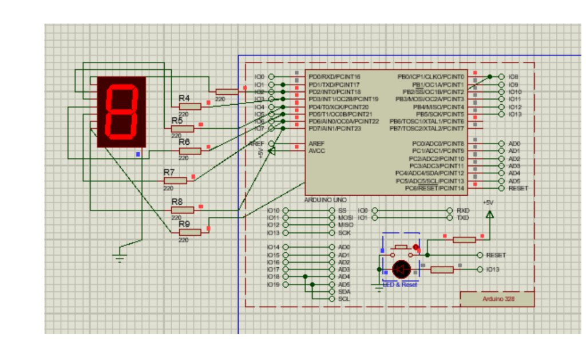

# Display Only Even Numbers on 7-Segment Display

## Aim
To interface a Common Cathode 7-segment display with Arduino UNO and display only even numbers (`0, 2, 4, 6, 8`) using an `if` condition.

---

## Important Concept
- **Concept Used**: `if (i % 2 == 0)` condition inside the for loop to filter and display only even digits.

---

## Circuit Connections

| 7-Segment Pin | Segment | Arduino Pin | Resistor |
|:---:|:---:|:---|:---|
| **a** | Top | **Pin 2** | 220Ω |
| **b** | Top-Right | **Pin 3** | 220Ω |
| **c** | Bottom-Right | **Pin 4** | 220Ω |
| **d** | Bottom | **Pin 5** | 220Ω |
| **e** | Bottom-Left | **Pin 6** | 220Ω |
| **f** | Top-Left | **Pin 7** | 220Ω |
| **g** | Middle | **Pin 8** | 220Ω |
| **COM** | Common Cathode | **GND** | Direct Ground |

---

## Circuit Diagram

