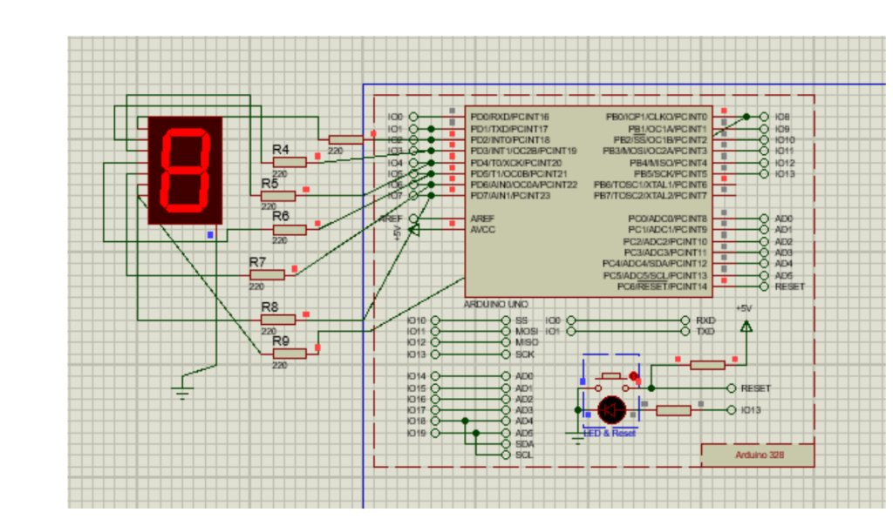

# Display Numbers in Reverse Order on 7-Segment Display

## Aim
To interface a Common Cathode 7-segment display with Arduino UNO and display numbers in reverse order (`9, 8, 7, 6, 5, 4, 3, 2, 1, 0`) using a decrementing loop.

---

## Important Concept
- **Concept Used**: Decrementing loop `for (int i = 9; i >= 0; i--)` to count downwards from 9 to 0.

---

## Circuit Connections

| 7-Segment Pin | Segment | Arduino Pin | Resistor |
|:---:|:---:|:---|:---|
| **a** | Top | **Pin 2** | 220Ω |
| **b** | Top-Right | **Pin 3** | 220Ω |
| **c** | Bottom-Right | **Pin 4** | 220Ω |
| **d** | Bottom | **Pin 5** | 220Ω |
| **e** | Bottom-Left | **Pin 6** | 220Ω |
| **f** | Top-Left | **Pin 7** | 220Ω |
| **g** | Middle | **Pin 8** | 220Ω |
| **COM** | Common Cathode | **GND** | Direct Ground |

---

## Circuit Diagram

